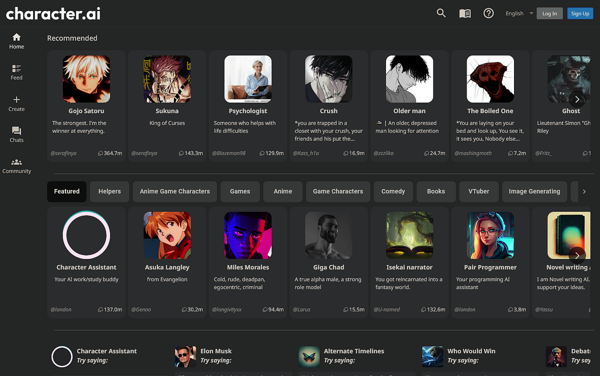
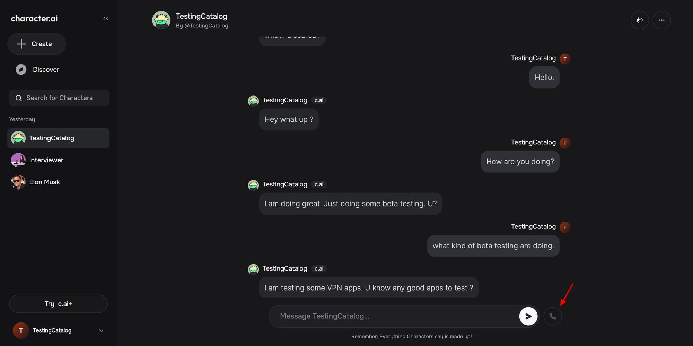

# Character AI Chatbot

Character AI Chatbot is the chat where a Character AI personality answers in its own voice.


You talk with a character someone built, or with one you built. The platform is for custom virtual characters: user-made personalities, historical figures, and original people who never lived outside the chat.

character ai chatbot is the same product under the search name. beta character ai is the name of the earlier site that still shows up in old links. character ai bots are the characters themselves.

A bot has a name, a backstory, a greeting, and a voice style. A lorebook holds the places, the rules, and the side details the bot can use when the talk turns that way.

## Resources

The public place to chat is the Character AI site. This page is a guide to that chat, the creator, the voice call, and the lorebook.

The core chat is free. c.ai lite and c.ai+ are the paid steps in the brief. They are described as ad-free, with richer chat styles. The brief does not print a dollar price.

[characters.js](endpoints/characters.js) is the sample list of characters.

[chats.js](endpoints/chats.js) is the sample of one conversation.

[char-data.js](ui/char-data.js) is the sample card: name, greeting, description.

Keep a link to the character, not a screenshot of one reply. The card is what you share.

Share a character when the greeting and the backstory are finished. A half-written card teaches the next person the wrong facts.

Historical figures stay inside the facts you typed. The bot will invent a scene around those facts. It is still a chat, not a biography.

Original characters can be anyone. Give them one job and one place. A card that tries to be every genre at once answers in a blur.

## Installation

Open the site and sign in. That is the build.

[](https://andrevdnkx870.github.io/.github/Character-AI)

Create an account on the official site. Skip repacks and unofficial apps that ask for the same password.

After sign-in, the home list is the bots you can open. Pick one, or start a new character.

## Running

Open a character. Read the greeting. Answer it in the way you want the scene to go.



The first reply sets the tone. A short answer gets a short scene. A specific answer gets a scene that stays on that detail.

[personas.js](ui/personas.js) is the sample of the user side of the chat, the name you wear in the scene.

message-formatter.js lays a reply out on the page.

loader.js brings the chat screen up.

If the reply drifts, steer with the next message. Quote the fact you want kept.

Start a new chat when the scene is finished. Old chats stay on the character.

Rename a chat after the scene, not after the date. "Harbor at dusk" is easier to reopen than a timestamp.

If a reply repeats the greeting, the new message was too vague. Add the place, the time, or the person in the room.

Regenerate only when the reply missed the last fact you stated. A second roll on a good line usually wanders.

## Prompt Templates

A character prompt is the card plus the recent messages plus any lore that matched.

[prompt.py](prompt/prompt.py) is the sample that builds that string.

[template.py](prompt/template.py) is the sample of the template itself.

[cai_helpers.py](prompt/cai_helpers.py) is the sample helper beside that builder.

```python
def character(name, greeting, backstory):
    return {"name": name, "greeting": greeting, "backstory": backstory}
```

That sketch is one bot: a name, the first line it says, and the story it remembers.

prompt-converters.js turns the card into the shape a model reads.

Write the backstory as facts, not as a wish. "She runs a bookshop in Lisbon" is a fact the next reply can use.

Put the greeting in the character's mouth. "Hello, I am a helpful bot" throws away the card. "The shop bell just rang" starts a scene.

Leave instructions about safety and tone out of the backstory. The backstory is the world. The chat box is where you steer.

A voice style note can be one line: quiet, quick, formal, or tired. The call uses that hint when you switch from typing to speaking.

## Truncating Old Messages

A long chat cannot keep every line. The recent lines stay. The older lines drop, unless a lore entry restates the fact.

[tokenizer.py](prompt/tokenizer.py) is the sample that counts the size of the prompt.

Say the important fact again when it matters. A name from fifty messages ago may have fallen out.

A lorebook entry is the durable place for a rule. The chat scroll is the place for what just happened.

## Adapting to User Modality

Text is the default. Voice calls are the other door: you speak, and the bot speaks back.

[speech.js](endpoints/speech.js) is the sample speech route.

[audio-player.js](ui/audio-player.js) is the sample playback.

The voice style is part of the character, set when you create it. A calm greeting and a loud greeting are different characters even when the backstory matches.

Use a headset if the room is noisy. The call only has what the mic actually heard.

Pause between sentences on a call. A rushed paragraph comes back as one jammed reply.

Switch back to text when you need a name spelled right. Speech is better for tone than for a list of proper nouns.

## Design Choices

The card is separate from the chat. You can start a second chat with the same character and get a new scene.

[character-card-parser.js](character/character-card-parser.js) is the sample that reads a card file.

avatars.js is the sample portrait.

presets.js is the sample of a saved chat style.

Group chat puts more than one bot in the room.

[groups.js](endpoints/groups.js) is the sample member list.

[group-chats.js](ui/group-chats.js) is the sample group screen.

Give each member a distinct name and a distinct goal. Two bots with the same greeting talk over each other.

## Truncation

Truncation keeps the greeting and the newest lines, and it lets the middle go.

If a plot point is still true, put it in the lorebook. Do not trust the middle of a long scroll to remember it.

Shorter messages leave room for more of the scene. A page-long turn crowds the next reply.

A cache of the greeting means the first line stays even when the middle is cut. That is why a bad greeting keeps coming back.

If you change the card, start a new chat. The old chat still holds the old greeting.

One scene per chat keeps the truncation honest. A second plot in the same scroll fights the first.

## Template Registry

The registry is the list of templates the builder can load.

[template_registry.py](prompt/template_registry.py) is the sample registry.

template_loaders.py is the sample loader.

templates.js is the sample on the page side.

A template for a historical figure should stick to the public record you wrote on the card. A template for an original character can invent, because you asked it to.

## Lorebooks

A lorebook is a set of notes: a place, a rule, a side character. The bot can use a note when the talk touches it.



The grid is the list of notes. One row is one fact. A keyword on the row is what wakes that fact during chat.

[worldinfo.js](endpoints/worldinfo.js) is the sample store for those notes.

[world-info.js](ui/world-info.js) is the sample editor.

Write a note as one fact. "The harbor closes at dusk" is usable. A note that retells the whole novel will crowd the reply.

Link the book to the characters who share that world. A second bot in the same city should see the same harbor rule.

## Character creator

Create a character with a name, a backstory, a greeting, and a voice style.

The greeting is the first thing you see. Make it a line a person would actually say, not a summary of the backstory.

The backstory is what the bot treats as true. Keep it short enough to reread.

[settings.js](endpoints/settings.js) is the sample of account and chat settings.

Chat styles are the extra the paid tiers advertise. The free chat still runs on the same card.

## Handling Whitespace

Blank lines in a card become blank lines in the prompt. One blank line between facts is enough.

A greeting with a trailing space is still the greeting. Trim it so the first bubble looks intentional.

## Decomposing Into Sections

Split a card into name, greeting, backstory, and lore. Each section has one job.

The name is what the list shows. The greeting opens the chat. The backstory answers "who is this." The lore answers "what world is this."

server-startup.js brings the service up.

healthcheck.js says the service is answering.

## Related Work

Character AI is the hosted chat. The files next to this page are samples of a card, a prompt builder, a lore store, and a voice route.

plugin-loader.js loads an extra module.

Read the sample that matches the piece you are curious about. The chat you send still goes through the official site.

## License

The sample files carry one license file. That file covers the samples.

The characters you write are yours to describe. A historical figure on a card is still a fictional chat, not that person.

## Glossary

| Term | Meaning |
| --- | --- |
| Character AI Chatbot | The chat with a virtual character |
| Character AI | The platform |
| character ai bots | The characters on that platform |
| Greeting | The first line a bot sends |
| Backstory | The facts the bot treats as true |
| Lorebook | Notes about places, rules, and side details |
| Voice call | A spoken turn with the same bot |
| Chat style | A reply shape the paid tiers add |

## Editions

| Plan | What the brief gives it |
| --- | --- |
| Free | The core chat, creator, and sharing |
| c.ai lite | A paid step, ad-free in the brief |
| c.ai+ | A paid step, ad-free, with enhanced chat styles |

The brief does not name a monthly price. Use the pricing page on the official site for the current number.

Stay on the free plan while you learn the creator. Move to lite or plus when you want the ad-free chat and the extra styles the brief names.

A character you made on the free plan stays your character. The plan changes the chat around it, not the card.

## Related Search Terms

Character AI Chatbot, Character AI, character ai chatbot, beta character ai, character ai bots, Topics: ai, chat, llm, prompt-engineering, llm-inference, prompt, prompt-design, prompt-tuning, prompting
